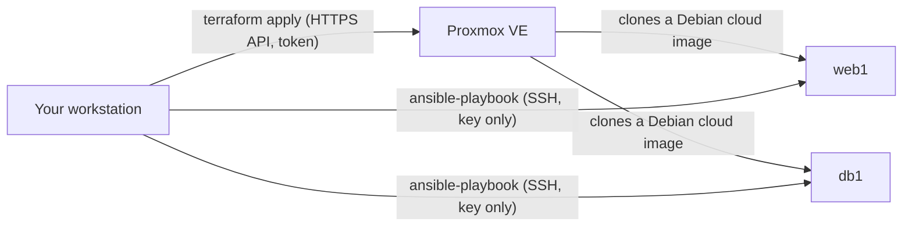

# homelab-as-code

[](https://github.com/VinceBono/homelab-as-code/actions/workflows/ci.yml)

A small Proxmox lab defined in code. Terraform creates the virtual machines from one list. Ansible gives every machine the same secure baseline. Rebuilding a machine is two commands instead of an afternoon.



## What you get

**Terraform** (`terraform/`): you describe machines in one variable, and each entry becomes a VM with a fixed address, your SSH key and an administrator account.

```hcl
vms = {
  web1 = { ipv4 = "192.168.10.21/24", groups = ["docker"] }
  db1  = { ipv4 = "192.168.10.22/24", cores = 4, memory_mb = 8192, disk_gb = 80 }
}
```

**Ansible** (`ansible/site.yml`): every machine gets

- automatic security updates
- SSH by key only, never as root
- a firewall that blocks all incoming traffic except rate-limited SSH
- the QEMU guest agent, so Proxmox can shut it down cleanly and show its addresses

Machines in the `docker` group also get Docker.

## Why this exists

A lab that only exists as clicks in a web page can't be reviewed, repeated or rebuilt. This repo is the smallest working shape of the alternative, with the secure settings as the starting point. No secret is stored in any file: Terraform reads the Proxmox token from the environment, and machines accept only your SSH key.

## Before you start

- Proxmox VE 8.4 or newer. The base image is imported with the `import` content type, which older releases don't have. Turn that content type on for the storage you use for images (Datacenter → Storage → `local` → Content).
- An API token for Terraform. Follow the [provider's guide to creating a token and its role](https://registry.terraform.io/providers/bpg/proxmox/latest/docs#api-token-authentication) and give it a dedicated user, not `root@pam`.
- Terraform 1.7+ and Ansible on your workstation.
- Free addresses on your lab network, outside the DHCP range.

## Use it

```bash
export PROXMOX_VE_ENDPOINT="https://pve.example.internal:8006/"
export PROXMOX_VE_API_TOKEN='terraform@pve!lab=<token secret>'

cd terraform
cp terraform.tfvars.example terraform.tfvars    # edit: gateway, your public key, your machines
terraform init
terraform apply
terraform output -raw inventory > ../ansible/inventory.ini

cd ../ansible
ansible-playbook site.yml
```

If your Proxmox certificate is self-signed, also `export PROXMOX_VE_INSECURE=true`. A trusted certificate is the better fix.

Other settings (node name, storage, bridge, base image, account name) are listed with their defaults in [`terraform/variables.tf`](terraform/variables.tf). Day-to-day tasks are in [`docs/runbooks.md`](docs/runbooks.md).

## How it's tested

CI runs on every change:

- **Terraform:** format check, `validate`, and `terraform test` against a mock provider. The tests check that each entry becomes one VM, that defaults apply, that the generated inventory is right, and that an address without a prefix length is rejected.
- **Ansible:** `ansible-lint`, then the baseline is applied to the CI machine itself, run a second time to prove it changes nothing, and the SSH and firewall settings are read back.

## Limits

- **It has not been applied to a real Proxmox server.** The mock provider checks the logic, not the API calls. Try it on a test node first and expect to adjust storage names.
- The Docker step isn't covered by CI.
- Terraform state is a local file. It's ignored by git; keep it somewhere backed up, because it's the record of what Terraform owns.
- One node, one network, fixed addresses. No clusters, VLANs, DNS records or backups yet.
- `.terraform.lock.hcl` isn't committed yet. Commit yours after the first `terraform init`.

## License

MIT.
